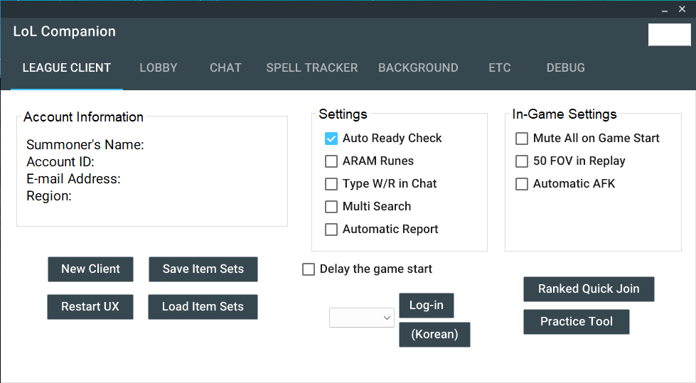
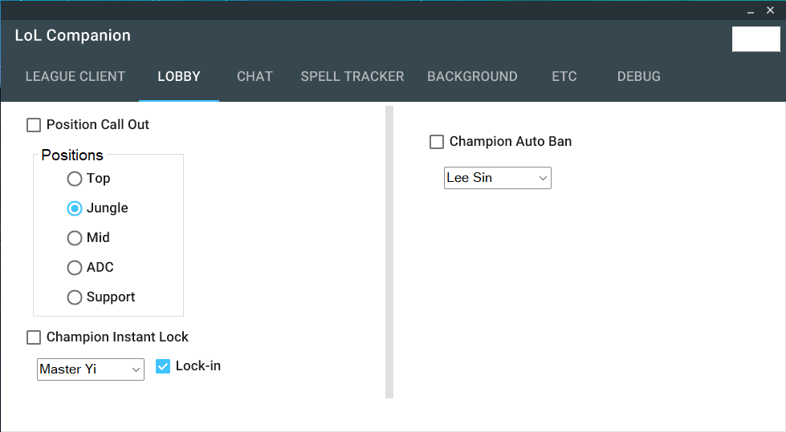
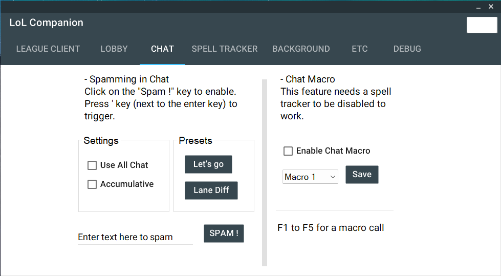
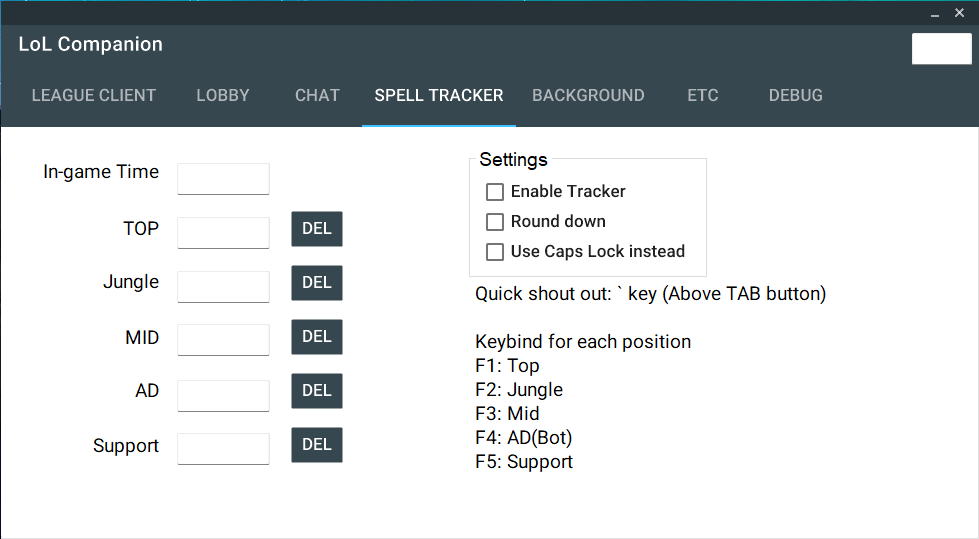

# LoL-Companion
Ultimate tool for your League of Legends Client

## Features
Duplicate client, Import and Export Item sets, Auto Login, Auto Ready-Check, Automatic Report, Position Call out, Champion Instant Lock & Ban, Chat Macro, Spell Tracker, Profile Background Changer, and so on.

## Saved accounts and Riot login

Edit `credentials.conf` beside the executable: comma-separated usernames on the first line,
shared password on the second. Account login is available in **Clients**. **Open Riot Client**
on the League tab opens/focuses Riot separately. The old single-account selector, Log-in and
Cancel Login controls and their separate game-launch workflow have been removed.

The Windows login code is a C# port of
[DangNghia17/ChangeLogin_Account_RiotClient](https://github.com/DangNghia17/ChangeLogin_Account_RiotClient),
commit `e822ff4f4ef049be13f07241e1f30477c230c88f`, specifically `riot_windows.rs` and `login_fields.rs`.
The upstream MIT license is included in `THIRD_PARTY_NOTICES.md`.
The selected Riot window must own foreground focus before keyboard input. The STA worker
creates its message queue, attaches to the foreground/target input queues, and retries activation.
UIA identifies and focuses each login field; keyboard input triggers the login form events.
Readiness checks start immediately after Riot launches and use visible, enabled login fields instead of a fixed ten-second window-stability wait. A cached window/owner check avoids repeated WMI lookups. The DPI-scaled clipboard probe runs in short batches after a 750 ms settling period when UIA has no fields, with the likely username area checked first. Login verification tolerates temporary local API startup failures. CAPTCHA/MFA is handled
in the official Riot UI. No password API request or automatic sign-out is used.

## Multiple Riot Client logins

In **Clients**, check the saved accounts and press **Riot Client 로그인**. The displayed count
follows the checked accounts. Each account opens an independent Riot Client, signs in, and
stops there. This flow sends no League product launch arguments or launch API requests and
does not wait for League/Vanguard startup. Launch a game manually from the desired Riot window.

Accounts and their shared password come from `credentials.conf`; **계정 목록 새로고침** reloads it.
Each new Riot Client uses a separate API connection and data directory under
`%LOCALAPPDATA%\LoL Companion\Clients`. Completion requires authenticated Riot session state,
the selected username, and a PUUID, with no pending authentication action or error.
Already signed-in selected accounts are discovered directly from Riot processes and retained,
including accounts without a League client. CAPTCHA/MFA is completed in the official Riot UI.
Cancellation or failure stops additional logins and retains the Riot clients already opened.
The status table shows Riot accounts and login state, plus League phase when available.
Checked accounts and the selected language are saved immediately in the `[Clients]` section of
`settings.ini` beside the executable, and restored on restart. Accounts are matched by username,
so reordering `credentials.conf` does not change which accounts are checked. Existing settings
and legacy files with the removed Log-in ID entry remain readable. Periodic status updates
modify existing table rows and preserve their selection, focus and scroll position.

Live verification on 2026-10-25 completed three distinct saved-account logins in separate Riot
instances, checked simultaneous authenticated session identities repeatedly, and confirmed that
no additional League process started. Both UIA field focus and the clipboard fallback were
exercised through the compiled production workflow, without Computer Use.

The previous multi-League launch attempt reached login `SUCCEEDED` on two accounts but the
second League client reported VAN 193. That launch and Vanguard verification path has been
removed from multi-account login. Riot's [VAN 193 guidance](https://support.riotgames.com/en-us/riot/performance/error-van-193/)
notes possible conflicts from multiple Riot sessions. Simultaneous usable League clients
have not been verified.

Every discovered League client has its own HTTP authentication and WebSocket subscriptions.
League and Riot HTTP requests share LocalApiHttpHandler, preserving the original explicit
TLS 1.2 setting and loopback certificate handling. A discovered League with a failed API
connection reports that failure in both the client table and account panel; it is not shown
as an absent client. Recovered connections reload account information.

Auto accept, champion pick/ban, position calls, champion-select chat and CC information use the
client that owns the event. Auto accept also finds ready checks pending before Companion started.
The original **Auto Ready Check** setting monitors ready checks on every running client.
The original **Quick Dodge** button checks all clients and acts only during champion select.
There are no additional accept/dodge buttons and no target dropdown.

Every existing manual action is dispatched to all running clients. Queue creation and practice
apply where the client is idle or in a lobby; position preferences apply to lobbies; background
changes, item sets and UX restart apply per account. A failure on one client does not stop the
other clients. Each multi-step workflow retains its own connection. Item-set export preserves
all accounts in one bundle, and import restores each account's matching data; legacy single
item-set files can still be imported into all clients. Reconnect retains all original in-game
connections. WebSocket debug logs include each client's PID.
## Dependencies
HtmlAgilityPack.1.11.43

InputSimulatorPlus.1.0.7

MaterialSkin.Updated.0.2.2

Newtonsoft.Json.13.0.1

WebSocketSharp-netstandard.1.0.1
